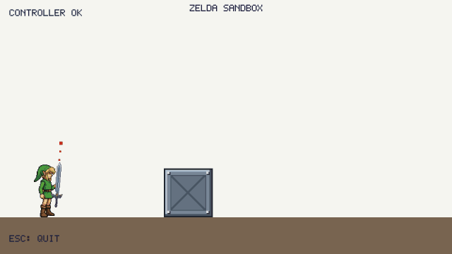
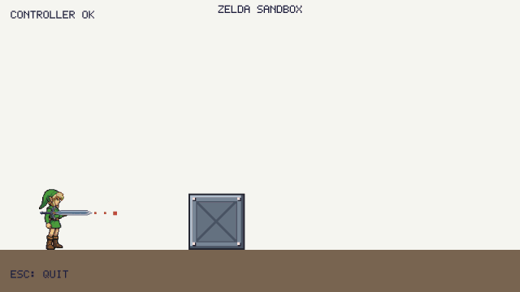

# Zelda-sandbox

A 2D sandbox for the mechanics of *Tears of the Kingdom* and *Breath of the Wild*, built in C++ and SDL2 (no engine, no physics library). I want to build almost all of the mechanics in those two games, as many as I have time for. It is the second project after [Zelda-Link.cpp](https://github.com/Trojanhammer/Zelda-Link.cpp), and a way to keep learning C++ and game physics.

**How it is organised:** every mechanic is built first in its own small sandbox, on its own, so I can understand it, test it and get it right before anything else gets in the way. Once each one works well, I will consider merging them into one world.


*Recall, the first mechanic: the left stick aims, X throws, O recalls it along the path it flew (the golden line and rim). The second recall happens after he walked away, so the sword falls and he walks back to pick it up. Recorded from the game itself, played by a scripted virtual gamepad and arrow keys.*

> **How this was built (AI use):** the mechanics and the physics (`Weapon`, `Player`, `Fire`, `Updraft`, `Magnesis`, `Box`, `Recall`, `Stasis`, the throw, gravity, landing, friction, the recall, walking and picking the sword up) are written by me, by hand: I discuss an idea with Claude, write it myself until I understand it, and ask Claude to review it. The exceptions, written with AI to move faster: the SDL2 window and drawing helpers (`src/graphics/`, including the legs that swing when Link walks and the metal box; `src/ui/`, which draws text with a built-in pixel font), the gamepad code (`src/input/`), the drawing lines in `main.cpp`, and the build script.

> **Disclaimer:** This is an unofficial fan project with no affiliation to Nintendo. *The Legend of Zelda* and its characters belong to Nintendo; this is built purely for personal learning and hobby purposes, with no plan to release or distribute it.

## Mechanics

| Mechanic | Status |
|---|---|
| Recall: throw a sword, then call it back along the way it came | done: aim and throw, rewind along the path it flew (in the air or from the grass), the sword falls if you walked away, and you can pick it up again. With a simple recall effect. The metal box can be recalled too (same `Recall` code), see the magnesis section |
| Updraft: fire heats the air above it and lifts things up | first version done: throw a fire, and Link is lifted while he stands in it (see below) |
| Magnesis: Link's power to grab a metal object and move it | first version done: hold R1 and move a big metal box any way with the right stick, and it glows while it is held (see below). Both tests pass: it carries its speed when I let go, and if I let go in the air it falls |
| Stasis: lock an object in time | first version works (see below): L1 freezes the box for 4 s, R2 hits it (the left stick sets the direction of each hit), a yellow tint, an arrow and a time bar show what is stored, and when time starts again it flies away with the speed the hits gave it. Still to do: only counting hits that are close enough, and a limit on how much it can store |

These come first, each in its own sandbox. The code is cleaned up first (the sword, fire and box each run their own states instead of one long `if` / `else if` chain in `main.cpp`), and Stasis is being finished now. Later I also want a Bokoblin as an enemy to try the mechanics on, and after that more mechanics from the two games as time allows.

### How the recall works here

- While the sword flies it records its position every frame. The recall plays those dots backwards and blends between the two nearest ones, so it moves exactly along the path it flew and takes as long as the flight, at any frame rate.
- You can recall in the air or after it landed. The sword ends where the throw began. If Link is still standing there it is back in his hand; if he has walked away, it falls to the ground (about 0.3 s from hand height) and can be recalled again.
- The recall works for 3 seconds after the throw began, and the flight counts: a 1.4 s flight leaves about 1.6 s after it lands. After that the path is forgotten and the button does nothing. A sword that lies still does not make the rewind wait.
- Walk up to a sword lying on the ground (within 50 px) to pick it up: it jumps into his hand and the old path is cleared.

### Recall effect

*Tears of the Kingdom* shows an effect on a recalled object. This is a simple version: a golden rim on the sword, a see-through copy where it will end up, and a golden line along the path back.

### How the updraft works here



*Updraft: the fire lands, grows and lifts Link, holds him at the top and lets him down as it fades (the long hold at the top is cut out; recorded from the game itself, played by a scripted virtual gamepad and arrow keys).*

- Square throws a fire. When it lands it burns for about 10 s: its strength grows, stays at the top, then fades.
- Gravity pulls every object down every frame, and the updraft adds a lift that works against it. Link is lifted once the lift is bigger than gravity (about 2.3 s after the fire lands), is held about 319 px up while the fire is at full strength, and comes down as it fades. He is only lifted while he stands within 10 px of the fire; if he steps out he falls.
- Only Link is lifted for now, not the sword. Throwing a new fire replaces the old one.

### How magnesis works here



*Magnesis: the box goes up, sideways and down at 100 px/s while R1 is held, hangs when the stick rests, and keeps its speed when I let go (recorded from the game itself, played by a scripted virtual gamepad).*

- Hold R1 (or `R` on the keyboard) to grab the metal box. While it is held the box moves at a constant 100 px/s towards where the right stick points, in any direction, down too (with the keyboard: the up and down arrows). With the stick at rest it hangs in the air. It glows red with a blue rim while it is held.
- Holding it only switches gravity off for the box; the movement is the same physics as everything else. Letting go changes nothing except that gravity is back on, so the box keeps the speed it had: let go while it moves sideways and it flies on sideways, let go while it hangs and it falls straight down.
- The speed is constant, so what it carries when I let go is at most 100 px/s. Only the box can be grabbed for now.


*Recalling the box: R1 and the right stick lift it and move it right, R1 is let go and it falls, then the triangle button sends it back along the path it flew, with the golden frame, line and see-through copy (recorded from the game itself, played by a scripted virtual gamepad).*

- The box has its own `Recall`, the same code as the sword's. It records its path from the moment it is let go (not while magnesis holds it), so a recall brings it back to where it was let go, and from there it falls again. The triangle button works while it flies or lies still, as long as there is a path to go back along. It gets the same golden look as the sword while it goes back: a golden frame, a see-through copy where it will end up, and a golden line along the path.

### How stasis works here


*Stasis: L1 freezes the box, four hits (R2) with the stick pointing up and to the right each add speed, the arrow grows, and when the 4 s are up the box flies away (recorded from the game itself, played by a scripted virtual gamepad).*

- L1 freezes the box for 4 s: no gravity and no speed, nothing moves. It turns yellow, an arrow shows where it will go (longer the more speed was stored), a bar above it shows the time left, and it flashes when it is hit.
- R2 is a hit. The n-th hit adds n x 50 px/s in the direction of the left stick at that moment (0 to 180 degrees, so up and to the right or up and to the left), so four hits in the same direction store 500 px/s.
- When the time is up the stored speed is given to the box once and the normal physics carries it: gravity, then friction on the ground. There is no limit on the stored speed yet: with the stick at 45 degrees three hits land about 100 px away, four about 270 px, and five about 990 px, which is past the first screen (the camera follows the box).

## Build and run

```bash
./build.sh && ./sandbox
```

Needs SDL2 and SDL2_image (`brew install sdl2 sdl2_image`).

## Controls

| Input | Action |
|---|---|
| Left / Right arrow | Walk |
| Left stick | Aim the throw (0 to 180 degrees) |
| X | Throw the sword (while it is in his hand) |
| O | Recall the sword (in the air or on the ground) |
| Square | Throw a fire |
| Triangle | Recall the box (after it was let go, in the air or on the ground) |
| L1 | Stasis: freeze the box (it stays frozen for 4 s, then flies away) |
| R2 | Hit the frozen box (the direction is where the left stick points) |
| R1 (or R), held | Magnesis: grab the box (let go and it falls) |
| Right stick (or Up / Down arrow), while R1 is held | Move the box |
| Esc | Quit |

## Files

| File | Purpose |
|---|---|
| `src/main.cpp` | Window, loop, input |
| `src/Weapon.h/.cpp` | The sword: position, speed and state (held, thrown, idle, recalling, falling); it has a `Recall` |
| `src/Recall.h/.cpp` | Records the path an object flew and rewinds along it (3 s limit); the sword and the box each have one |
| `src/Player.h/.cpp` | The player walks, holds the sword, throws things, and runs the sword's states in `UpdateWeapon` |
| `src/PhysicsObject.h/.cpp` | What everything that moves shares (position, speed, gravity, lift); `Weapon`, `Player`, `Fire` and `Box` inherit it |
| `src/Fire.h/.cpp`, `src/Updraft.h/.cpp` | The thrown fire (it runs its own states in `UpdateFire` and owns its updraft), and the updraft it makes when it lands |
| `src/Box.h/.cpp`, `src/Magnesis.h/.cpp` | The metal box (idle, magnesis, fly, recalling, stasis), and the magnesis that sets its speed while it is held |
| `src/Stasis.h` | Counts the hits while the box is frozen: the n-th hit adds n x 50 px/s in the direction of the stick, and it tells when the 4 s are up |
| `src/graphics/` | Drawing only: ground, hand, a sword that turns, a dotted aim line, a marker, loading / drawing / turning sprites, Link with swinging legs, the metal box, its recall and stasis effects, and the ground marks |
| `src/graphics/camera.h/.cpp` | The camera: the world is 6000 px wide and the window shows 960 of it. It follows Link, and the box while it flies sideways, and never shows outside the world. Everything is still drawn at its world position |
| `docs/` | The GIFs shown in this README |
| `assets/` | `link.png` (Link without a weapon), `master-sword.png`, `flame.png` and `fireball.png`, pixel art generated with AI and cleaned up (background removed, shrunk, 24 colors) |
| `src/input/` | Gamepad: the left stick aims (as a throw angle), X throws the sword, O recalls it, square throws a fire, triangle recalls the box, L1 starts stasis, R2 hits, R1 held and the right stick for magnesis |
| `src/ui/` | Text drawn with a small built-in 5x7 pixel font (no SDL_ttf) |
